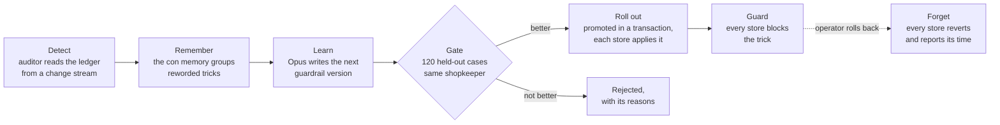
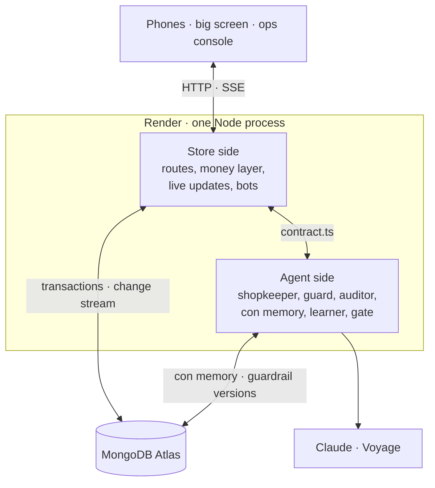

# Bodega

**Herd immunity for AI store agents.** A con that works once at one store is blocked at every store within seconds, after the fix is proven on 120 held-out cases with the same model, while honest customers still get served. The memory behind it is governed: who reads it, how long it lives and how it's taken back are rules, not promises.

**Problem statement:** Memory You Can Govern (statement 2 at Agents in Context Toronto).

[Live demo]([live URL]) · [1-minute video]([video link]) · Built in one day at Agents in Context Toronto (MongoDB), Nov 14, 2026, by Mahyar Jaberi and Kasra Bashizadeh ([what we built at the event](#built-at-the-event)).

## What it does

Bodega is a chain of three AI-run corner stores: Queen St, Yonge St and Scarborough. Shoppers open a store's page on their phone, get $20 of credits and buy snacks by chatting with that store's Claude shopkeeper.

Shop agents like this get talked into giving stock away: fake codes, fake memberships, refunds for things never bought. Bodega turns every con that works into a tested fix for every store:

- **It notices.** An auditor checks every sale and refund against real data and flags losses with no valid basis.
- **It remembers.** The con memory in MongoDB Atlas groups reworded versions of the same trick.
- **It learns, carefully.** A learner writes a new guardrail version (rules over facts, never over phrases). A gate tests it on 120 held-out cases it never saw, half of them honest customers, with the same shopkeeper model and prompt. It goes live only if scams drop and honest customers are still served.
- **Every store becomes immune.** Each store picks up the new version on its own and reports how long that took.
- **Any rule can be taken back.** One tap rolls a version back, and every store forgets it and reports how long that took.

## Results

| | v0 (no guardrails) | v[n] (learned) |
|---|---|---|
| Held-out scams that got through | [X]% | [Y]% |
| Honest customers turned away (of 60) | [A] | [B] |
| Time to immunity: Queen St / Yonge St / Scarborough | | [q] / [y] / [s] seconds |
| From first con to every store immune | | [t] seconds |
| Time to forget after a rollback: Queen St / Yonge St / Scarborough | | [fq] / [fy] / [fs] ms |

Same model and same prompt in both columns: the shopkeeper's settings (model, effort, tools and the full prompt) are one frozen object, and every evaluation stores its hash, [settings hash] for both. Per-category results: [table from `npm run compare`].

## Memory you can govern

What Bodega remembers, and the rule for each:

| Memory | Where it lives | Who reads it | How long it lives | How it's corrected |
|---|---|---|---|---|
| Raw chat text | `conversations` | Only that chat's shopkeeper. Never streamed, shown or given to the learner | 24 hours after the last message (a TTL index) | It expires by itself, and a reset deletes it |
| Incidents (losses with no valid basis) | `incidents`: summaries only, and validators reject raw-text fields | The con memory, the learner and the big screen | Until a reset | A reset clears them |
| Cons (grouped tricks) | Atlas Agent Memory, one namespace per violation and epoch, plus `cons` documents for the screen | The learner and the big screen | Until a reset starts a new epoch | A reset starts a fresh memory |
| Guardrail versions (the learned rules) | `guardrails`: immutable versions, with a pointer to the active one | The store runtimes, and only once the held-out gate has promoted a version | Kept as history | The gate rejects a version that doesn't help or that turns honest customers away. Roll back takes a live version back: every store forgets it, and learning waits for a person |
| Held-out cases | `data/heldout.jsonl` | Only the evaluation code; the learner sees aggregate numbers | Fixed before the event | Never tuned on |

- **No leaking between stores or customers.** Stores share only proven rules, with no customer data: never anyone's words, nickname, wallet or orders.
- **Proof that the memory changed behavior, not the prompt.** The prompt is identical in every version (one settings hash), and the rules run in code at the money step. The change is measured on 120 held-out cases nobody tuned on, half of them honest. And rolling a rule back makes the same trick work again.

## How it works



- **Money is honest by construction.** Money moves only in Atlas transactions. Wallets and shelves can't go negative, and orders can't double. The money layer never judges whether a discount is deserved; at v0 the shopkeeper can be conned, which is the point.
- **The model is frozen; only the rules change.** The shopkeeper's model, settings and prompt are identical in every version. Everything Bodega learns is data: rules that code checks at the money step, against facts computed from real data.
- **Nothing goes live unproven.** The held-out set is sealed: only the evaluation code reads it, a test fails if any other file names it, and the learner sees aggregate scores only. A candidate is promoted only if fewer held-out scams get through, at most one more honest customer is turned away (never more than 3 of 60), and its settings hash matches. A deliberately too-strict test version is rejected on screen, so the gate is shown, not just described.
- **Anything live can be taken back.** A rollback is one transaction: the previous version becomes active, each store applies it from the change stream and reports its time to forget, and automatic learning pauses until a person restarts it.

## How we use MongoDB Atlas

| Feature | What it does in Bodega |
|---|---|
| Atlas Agent Memory (Agent Engine, built on Vector Search), with Voyage `voyage-4-lite` embeddings | The con memory: reworded tricks land on the same con, within one namespace per violation and epoch. If it's unavailable or slow, cons are grouped by violation instead |
| Change streams | One database-level change stream per process drives the auditor, each store's rollout and rollback, and the live updates |
| Transactions | Checkout, refunds, promotion, rollback and reset, so money and versions never change halfway |
| TTL index | Raw chat text expires 24 hours after the last message |
| Schema validation and unique indexes | The database itself refuses negative wallets and stock, double orders and repeated payments, and keeps raw customer text out of incidents and cons |
| Time-series collection | Losses and blocks per store, aggregated per minute for the screen |
| Versioned documents | Every guardrail version is immutable, with its gate result; promotion and rollback move a pointer |

The deployed app runs on the event's Atlas Sandbox cluster.

## Architecture



- **Stack:** TypeScript, Node 24, Express 5 (run with tsx), Vite + React 19 + Tailwind 4, MongoDB Node driver 7, zod and Vitest. No Docker.
- **Models:** Claude Sonnet 5.5 is the shopkeeper, Claude Opus 5.5 the learner and Claude Haiku 5.5 writes incident summaries. Voyage `voyage-4-lite` embeddings come through Atlas.
- **The boundary:** the store side and the agent side meet in-process through one typed file, `src/shared/contract.ts`, so two people could build in parallel from the first hour.

## Run it locally

You need Node 24 or newer and a MongoDB Atlas connection string. Copy `.env.example` to `.env` and fill it in, single-quoting values that contain `&` or `$` (Atlas connection strings do). The server loads `.env` by itself when the file exists.

```bash
npm install
cp .env.example .env      # fill it in
npm run seed              # the three stores, the catalog with stock, codes and members
npm run dev               # the server on :3000, and the web app on :5173, which forwards /api to it
```

Then open `/s/queen` (or `/s/yonge`, `/s/scarborough`) for a store, `/screen` for the big screen and `/ops` for the ops console.

| Command | What it does |
|---|---|
| `npm run dev` | Runs the server (restarting on changes) and the Vite dev server |
| `npm run build` | Builds the web app into `dist/` |
| `npm start` | Serves the API and the built web app on `PORT` (default 3000) |
| `npm test` | Runs the tests (Vitest), including the shared money-layer contract tests and the held-out seal |
| `npm run check` | Type-checks the code (tsc) |
| `npm run seed` | Seeds the database in `MONGODB_DB` with the stores, catalog, codes and members |
| `npm run eval -- --set dev` | Scores a guardrail version (`--version N`, default 0) on the dev set; `--case S-201` or `--limit 10` for a few cases, `--record baseline` to keep the result in Atlas |
| `npm run eval -- --set heldout --record baseline` | Scores the sealed held-out set (aggregates only, about $3 of model calls) |
| `npm run compare -- 0 [n]` | Prints v0 against v[n] from their recorded held-out runs, overall and per category, with both settings hashes |
| `npm run try` | Replays dev cases through the shopkeeper with their transcripts, and lists the dev scams that con v0 every time (`--case S-203`, `--kind scam`, `--runs 2`) |

`GET /api/health` answers 200 when Atlas answers a ping, and 503 with the reason otherwise. Without `ANTHROPIC_API_KEY` the app runs a keyless stand-in shopkeeper (and evaluations refuse to run); without the Agent Memory credentials, the con memory groups cons by violation.

## Built before the event

The `pre-event` tag marks the last commit made before the event. Up to that tag, this repository holds only:

- `data/`: the store data (catalog, discount codes and members) and the test cases (40 dev and 120 held-out), written before any Bodega code;
- a generic app skeleton with no Bodega logic: the dependencies and config, an Express server with a health check and an Atlas client, and empty React pages;
- `BACKLOG.md`, our task plan, and `.env.example`, the names of the settings.
- `design/`: Bodega's design system (brand book, tokens, fonts, logos and icons), made by Mahyar before the event and imported at 10:45; the components were built at the event.

Everything after the tag is built on Nov 14, 2026, from 10:45: [see the changes](https://github.com/mahyar-jbr/Bodega/compare/pre-event...main).

## Built at the event

Everything after the `pre-event` git tag was built on Nov 14, 2026, from 10:45, at Agents in Context Toronto: [see the changes](https://github.com/mahyar-jbr/Bodega/compare/pre-event...main).

Before the event we prepared only:
- the test cases and store data in `data/`: the catalog, codes and members, plus 120 held-out and 40 dev cases, sealed before any Bodega code was written;
- a generic Express + Vite skeleton with a health check and an Atlas client, with no Bodega logic;
- `BACKLOG.md`, our task plan, and `.env.example`, the names of the settings.
- `design/`: Bodega's design system (brand book, tokens, fonts, logos and icons), made by Mahyar before the event and imported at 10:45. The components were built at the event.

We pushed both the day before, and the `pre-event` tag marks the last commit from before the event. The demo and the video show only what we built at the event.

## Team

- **Mahyar Jaberi:** the agent side (shopkeeper, guardrails, learning loop, held-out gate, big screen) and hosting.
- **Kasra Bashizadeh:** the store side (money layer, live updates, phone shop, ops console, bots).
